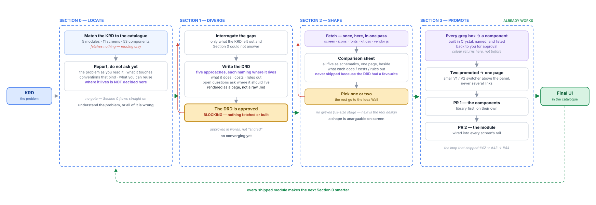

# The design method

How a problem becomes a page. Four sections, **one** blocking gate.

This file is the instruction set behind the `slipstream` skill. Reading it is
enough to run the method by hand; the skill just removes the fetching.



## Reading the diagram

The four sections run left to right. Each one ends in a **gate** — the amber
box — and nothing moves right until that gate is answered. The arrows carry
meaning:

| | |
|---|---|
| **green →** | the gate passed; go on |
| **red ↰** | the gate failed; go back to the top of this section and re-run |
| **green dashed, underneath** | the finished module becomes catalogue, which makes the next Section 0 better |

### Section 0 — Locate · *what already exists*

| step | what happens |
|---|---|
| **Match the KRD to the catalogue** | Read `pages.md` and `components.md` and find what this problem touches. **Nothing is fetched** — no screens, no icons, no fonts. They may belong to a page that is about to be ruled out. |
| **Report, do not ask yet** | The problem as you read it, what it touches, the conventions that bind the work, and what already exists to reuse. **No gate here** — Section 0 flows straight into Section 1. |
| | **Where it lives is not decided here.** That is one of the things the five approaches differ on, so it belongs in the DRD. |

### Section 1 — Diverge · *what we could do*

| step | what happens |
|---|---|
| **Interrogate the gaps** | Ask only what the KRD left out *and* Section 0 could not answer. Never re-ask what the catalogue already knows. |
| **Write the DRD** | Five genuinely different approaches — what each does, what it costs, what it rules out, and **where each one would live**. Rendered as a page and opened in the browser, never handed over as a raw `.md`. The open questions ask where it should live, with a recommendation. |
| **🔒 The DRD is approved** | **The one hard stop.** Not *shared*, not *sent* — approved, in words. Nothing is fetched and nothing is built until it is. No converging before this either: shapes are compared on screen, not as sentences. |

### Section 2 — Shape · *what it looks like*

| step | what happens |
|---|---|
| **Fetch — once, here** | One batched pass: the screen, only the icons it references, the three fonts, `kit.css`, and any vendor script its markup links. |
| **Comparison sheet** | All five approaches as small schematics on one page, each beside what it does, costs and rules out. Schematic on purpose — the question is *which shape*, not *is this spacing right*. **Never skipped because the DRD named a favourite**: liking an approach in prose is not the same as seeing it. |
| **🔒 Pick one or two** | The losers go to the Idea Wall. **There is no greyed full-size stage after this** — once a shape is chosen, the next useful artefact is the design itself. |

### Section 3 — Promote · *make it real*

| step | what happens |
|---|---|
| **Every new block becomes a component** | Built in Crystal tokens, named, and listed back for approval. Colour returns here, and not before. |
| **Two promoted → one page** | A small `V1 / V2` switcher above the panel. Comparing means flicking between them in the same spot; separate links lose the alignment. |
| **PR 1, then PR 2** | Components first, on their own, so nothing depends on something not yet upstream. Then the module, wired into every screen's rail. |

### The loop underneath

The shipped module is now in the catalogue, so the next Section 0 starts from
a better map. That is the whole point of the dashed line — and it only keeps
working while promoting stays cheap. The moment it becomes a chore, the
catalogue starts going stale and Section 0 starts lying.


---

## Section 0 — Locate

**Automatic. No human input, no gate, nothing fetched.**

> Section 0 is reading. The pack is all you need — no screen files, no icons,
> no fonts, no stylesheet. Those come in **one batched pass** later, once the
> DRD has been approved. Fetching early spends the user's time on files that
> may belong to a page they are about to rule out.

Before anything is designed, establish what already exists. Skipping this is
how approaches get invented in a vacuum and the final UI lands off-spec.

1. Read [panel-principles.md](panel-principles.md) **first** — who the captain
   is, and the panel's standing failures. Several entries there contradict
   assumptions a page is easy to build on: the panels are **merging**, so design
   for a captain working inside this one **all day under operational pressure**,
   not the end-of-day reporter they are today; **WhatsApp is the competitor**;
   there is **no homepage**, so nothing can assume where they arrived from.
2. Read [pages.md](pages.md) and [components.md](components.md).
3. Match the KRD against them.
4. Report, without asking anything yet: **the problem as you read it**, the
   modules and screens it touches, the conventions that will bind the work,
   and what already exists that can be reused.

> **The prerequisite: understand the problem properly first.** This is not a
> step, it is the ground everything else stands on. A misread problem produces
> a correct-looking DRD, five careful approaches and a finished design that
> solves the wrong thing — and nothing downstream will catch it, because every
> later stage inherits the misreading. If the KRD is thin, the right move is
> to go back to it, not to proceed carefully.

> **Do not decide where it lives here.** Where a thing goes is one of the
> things the five approaches *differ on* — settling it before they exist
> collapses the design space to whatever seemed obvious first, and the DRD
> then diverges inside a box nobody argued for. It belongs in the DRD, and
> the question belongs in the DRD's open questions.


## Section 1 — Diverge

**You drive. The DRD is a blocking gate: nothing is built until it is approved.**

> This was non-blocking in the first version, to protect cycle time. After a
> real run it was changed: the DRD was skipped, wireframes were built against
> nothing written down, and an approach nobody had considered turned out to be
> the right one. **The gate is worth the day.**

1. **Interrogate the gaps** — ask only what the KRD left out *and* Section 0
   could not answer. Do not re-ask what the catalogue already knows.

   > **A question about the KRD is about what the KRD does not say. A question
   > about the design is yours to decide and state.** Mixing them makes the
   > reader adjudicate your design choices as though they were facts. Order
   > questions by how much design they change, and always say what you will do
   > if they go unanswered.

2. **Sweep for the cases the KRD did not mention.** A KRD describes the happy
   path almost every time. The edge cases are not missing because they do not
   matter — they are missing because nobody thought of them, and that includes
   you unless you work from a list:

   | generator | ask |
   |---|---|
   | **data** | missing · zero · stale · exactly one · thousands · *exactly at the threshold* |
   | **time** | the first ever · mid-transition · after a long absence · the current, incomplete period |
   | **permission** | the user cannot act · a different role is looking |
   | **lifecycle** | before · during · after · reverted |

   Run it and the capacity-cut KRD immediately gives up: *exactly at 2pp* ·
   *a new DC that is exempt* · *already at the 100-order floor* · *every metric
   green but no new FE* · *this week's data incomplete*. **The KRD covers none
   of them.** Each one becomes either a constraint or a success test, and each
   one has to appear as a situation in the shapes.
3. **Write the DRD** — `DRD.md` as the source, then render it to a page and
   **open it in the browser**:

   ```bash
   python3 scripts/render_doc.py DRD.md
   ```

   Handing over a raw `.md` hands over the *source* of a document, not the
   document. It reads badly, and approving it feels like reviewing a diff.

   **Every approach entry carries the same six parts, in this order:**

   | part | what it is for |
   |---|---|
   | **What the captain does** | the numbered journey — see step 6 |
   | *one or two lines* | what the thing actually is |
   | **Wins when · Costs · Rules out · Leans on** | the trade, compressed |
   | **Why it can work** | the argument *for* it, taken seriously |
   | **What would make it fail** | the one thing that would sink it |

   > **Argue every approach as though it were the one being built.** An
   > approach written only as a trade-off line is a straw man, and a set of
   > straw men is not a choice — it is the recommendation with scenery. The
   > reader must be able to disagree with you from the page itself.

   Keep each to a short paragraph. Detail earns its place by changing
   somebody's mind; past that it is bulk, and bulk does not get read.

4. **As many approaches as the problem actually has.** Not five for the sake
   of five. For each: what it does, what it costs, what it rules out, and
   **where it would live**.

   ### Approaches are derived from the brief, not invented

   **Do not think of approaches and then check them against the axes.** By the
   time you have thought of three, you have already anchored on whichever came
   to mind first, and the check only confirms it. Build the candidate set out
   of the lists the brief already wrote:

   | axis | where its span comes from |
   |---|---|
   | **where it lives** | **every module the brief's *what it touches* named.** Each one is a candidate approach until ruled out *in writing*. |
   | **who acts** | every actor the brief extracted — the user, another role, the system acting and then informing |
   | **when it is surfaced** | the moments in the brief's **situations**: before the event · at the decision · on the event · after it |
   | **what is shown** | everything · only the exception · only the action |
   | **how it is framed** | status · warning · instruction · explanation · score — *and add one if the problem admits another* |
   | **depth** | summary · item level · both |

   This is why it is generative rather than a checklist: the brief named the
   modules, the actors and the moments, so the candidates already exist. You
   are selecting and pruning, not imagining.

   > **Every module named in *what it touches* appears in the approach table,
   > or is ruled out in a sentence.** Nothing from the brief may silently
   > vanish. In the capacity-cut run, Growth Dashboard was named in the brief
   > and then simply absent from the approaches — not rejected, absent — and
   > nothing caught it but a human reading the table.

   > **Placement is one axis, not the excluded one.** An earlier version of
   > this file said placement was "the entry axis, not the design axis", and
   > the next run stopped varying placement at all. Vary placement **and** the
   > rest. A set that moves only on placement is thin; a set that never moves
   > on it has thrown away a whole dimension.

   Place every approach on the table and show it. A set clustered on one point
   is visibly thin, which is the entire purpose of writing it down.

   > **The discriminator.** Two approaches are the same if switching from one
   > to the other **does not change what the user does**. If their behaviour
   > is identical, it is a variant, not an approach. Same look, different
   > behaviour: two approaches. Different look, same behaviour: one.

   ### How many

   The count follows the problem. **If the honest answer is two, write two** —
   and say why there are only two. Padding to five produces three real ideas
   and two costumes, and the costumes waste the reader's attention in exactly
   the place it is most needed.

   **If they cluster, stop and ask.** When three approaches turn out to be the
   same idea in different clothes, say so, name the real fork underneath them,
   and ask which side of it to explore. A clustered set is not a failure to
   report — it usually means the problem has one obvious shape and a single
   real question, and naming that question is worth more than five options.

5. **Ask where it should live in the DRD's open questions**, with your
   recommendation and the one reason that decides it. By then the approaches
   are on the page, so the question gets answered against something real
   instead of in the abstract.

### Where it can live

There are only ever two answers, and the first has three placements inside it.
**Every approach in the DRD names its own placement** — that is part of what
makes the approaches different from one another.

> **The prerequisite: understand the problem properly first.** This is not
> a step, it is the ground everything else stands on. A misread problem
> produces a correct-looking DRD, five careful approaches and a finished
> design that solves the wrong thing — and nothing downstream will catch
> it, because every later stage inherits the misreading. If the KRD is
> thin, the right move is to go back to it, not to proceed carefully.

**1 — In an existing module.** Name which one, and why that one. The three
placements are a **ladder, not a menu**: each rung costs more than the one
below it, so take the lowest rung that genuinely serves the problem.

> **Before proposing any new surface at all, ask whether a control removes
> the need for one.** A date dropdown, a filter, a toggle or a sort on what
> is already there will often do the whole job. *"Show me last week"* is a
> date control, not a screen. A new tab or page proposed where a filter
> would have done is work nobody needed, in a place nobody will look.

> **Depth costs visibility, and that is a real trade — say it out loud.**
> A nested page is seen by whoever goes looking for it. If you recommend
> 1c, name that cost in the same breath: *"this fits here, but it will be
> seen less because it sits inside."*
>
> **It is a cost to state, never grounds to rule a placement out** — not
> even when the problem itself is one of awareness. If the placement is the
> best fit and everyone agrees the visibility is enough for what is being
> built, it ships. The method's job is to put the trade in front of the
> person deciding, not to decide for them by quietly removing an option.

| | placement | when it is right |
|---|---|---|
| **1a** | **on the existing page** — stack another section vertically, *or* extend a section already there, horizontally or vertically (a column, a field, a state) | it fits on that page |
| **1b** | **a tab or sub-tab** | it does **not** fit on that page — adding to or removing from it stops making sense — but it belongs to the same subject, so a tab lets the module hold both |
| **1c** | **inside a nested page the module already has** | it belongs to one item's detail, not to the module's main view |

> **When two modules both seem to own it.** This is common — pilot
> productivity touches capacity *and* the roster. It is not a reason to
> reach for a new module, and it is never a reason to build the thing twice.
>
> 1. **Pick the module where it makes more sense to live.** That is its
>    home, and it is built once, there.
> 2. **At the other touchpoint, add a door** — an entry point, or a line
>    explaining the new thing and linking to it. That keeps the two subjects
>    correlated and sends traffic to the home.
> 3. **Never build the same thing in both places.** Two homes means two
>    things to maintain and, before long, two versions of the truth.
> 4. **If you genuinely cannot pick, say so and ask** — and give your
>    reasoning for each side, not just the question. A decision made with
>    the reasoning in the open is one the next person can learn from; a bare
>    "which one?" teaches nobody anything.

**2 — A new module in the rail.** Only when no module owns the subject.
Expensive: it has to earn a permanent slot, which usually means someone
opens it as part of a routine.

> **A module having no tabs today is not an argument against a tab.** Any
> module can take one — the component exists, and which modules happen to
> use it now says nothing about which may. The same goes for sub-tabs and
> nested pages. Judge by whether the thing fits the page, never by the
> page's current furniture.

Within 1a, [section-rules.md](section-rules.md) decides *new section* from
*extend what is there* — **own heading plus own data scope** is the test.

**Worked example — "show the capacity cut history, last five weeks".**
Both of the obvious answers are wrong, and for the same reason.

| reading | answer it suggests | why it is wrong |
|---|---|---|
| it is about the whole DC, not one item | a tab | if the ask is only *show the weeks*, a section on the page already there carries it — or it goes at the top of the first section. A tab buys nothing. |
| you would reach it from the "cut this week" card | a nested page | if the overview has a date control, clicking any week already shows that week. The page is not needed at all. |

The answer is **1a**, and the thing that decides it is the size of the
problem, not the shape of the navigation. Both wrong answers come from
reaching for a new surface before asking whether the existing one could
carry it.


6. **Give every approach the captain's journey.** Not a description of the
   screen — the numbered steps the captain actually takes, from what sets them
   off to the point where they know what to do.

   | step | what it names |
   |---|---|
   | 1 | what starts it — a notice, a habit, a task they were already doing |
   | 2 | where they land |
   | 3 | what they read |
   | 4 | what they do next |
   | 5 | what they now know |

   Write it **before** the trade-offs. It is the thing that exposes a shape
   that cannot finish — and a shape reads as plausible for exactly as long as
   nobody walks through it.

   > In the capacity-cut run, approach **B** ended at *"They stop there.
   > Nothing on the page says how to undo it."* That one line ruled it out
   > faster than its test coverage did.

   The journey appears twice, word for word: in the DRD entry, and beside the
   schematic in Section 2. If drawing the shape changes the journey, the DRD
   is updated too.

7. **Do not converge yet.** Converging here is what makes the whole exercise
   theatre: the shapes are compared as sentences, when the thing that actually
   decides it is seeing them laid out.

> **Approach ≠ IA.** Diverge here on *what we do about the problem* — surface it
> on an existing screen, give it a dedicated page, make it a notification.
> Structure comes next. Diverging on both axes at once gives fifteen options
> that are really three, and nobody can review that.

**Gate — the DRD is approved.** Hard stop. Not "shared", not "sent" —
approved, in words, by the person who asked for the work. Revise and re-render
until they say it is good to go.

Only then does anything get fetched or built.

## Every answer goes back into the artefacts

**An answer given in chat is not a decision until it is written down.** The
moment the user answers anything — a gap, an open question, a correction —
update the brief and the DRD **before doing anything else**, and show what
changed.

Three reasons this is not bookkeeping:

- **Later steps check against the brief.** If the brief still says something
  the user has since overturned, the final check validates against a document
  everyone has stopped believing.
- **The reasoning evaporates otherwise.** The chat is gone next week. The
  brief is what someone reads in six months to understand why the page looks
  like this.
- **An answer often changes more than the question it answered.** In the
  capacity-cut run, *"ignore AMs"* did not just delete a constraint — it
  removed an entire approach, because that approach existed to be read by a
  captain and an AM together. **Say that out loud.** A silently shrinking
  option set looks like carelessness; an explained one is the method working.

Report it as a diff, not a redraft: *what was open · what the answer is · what
it changed.*

> **IDs freeze once the brief is approved.** Before approval, renumber freely.
> After it, a withdrawn constraint is **marked withdrawn, never deleted**, and
> new facts take new numbers. Renumbering after other documents reference
> `C4` silently repoints every reference to something else — and nothing in
> the checks would catch it.

## Section 2 — Shape

**Starts only after the DRD is approved.** This is where the real gate is.

**Fetch once, here.** One batched pass for everything the build needs — the
screen, only the icons it references, the three fonts, `kit.css`, and any
vendor script its markup links. Not before, not drip-fed.

**All five approaches on one page**, each a small schematic beside **the
captain's journey**, what it does, what it costs, and what it rules out.

**The rail is part of the schematic.** It carries the real module names, and
each card lights the module that approach actually lives in. Anonymous bars —
or the same bar lit on every card — produce a placement comparison that says
nothing about placement. See `comparison-example.html`.

**Draw the situations, not only the happy path.** Every situation the brief
numbered gets a mark against each shape: lit where the shape has room to show
it, faded where it does not. A shape that is blank in four situations out of
seven is not a cheaper option, and the sheet is where that becomes visible
rather than arguable.

> **Never skip this sheet because the DRD already drew a favourite.** Liking
> an approach in the DRD is liking a *paragraph*. That is the thing this whole
> method exists to avoid — Section 1 says not to converge precisely because
> shapes argued as sentences lose to shapes seen side by side. A preference
> stated from prose is provisional until it has been looked at.
>
> Build the sheet, show it, and let the preference survive or change. The user
> may still say *"skip it, build A and B"* — that is their call to make out
> loud. It is never yours to make on their behalf by reading ahead.

> **Never skip this sheet because the DRD already drew a favourite.** Liking
> an approach in the DRD is liking a *paragraph*. That is the thing this whole
> method exists to avoid — Section 1 says not to converge precisely because
> shapes argued as sentences lose to shapes seen side by side. A preference
> stated from prose is provisional until it has been looked at.
>
> Build the sheet, show it, and let the preference survive or change. The user
> may still say "skip it, build A and B" — that is their call to make out
> loud. It is never yours to make on their behalf by reading ahead. Build it with the `wfc-` classes
in `assets/wireframe.css`; [comparison-example.html](comparison-example.html)
is the standard.

1. **IA outline first** — header, then sections in order, then what is in each.
   Check it against [section-rules.md](section-rules.md) before drawing.
2. **Schematic, on purpose.** The question here is *which shape*, not *is this
   spacing right*. Five full-size pages is too much scrolling to compare, and
   the rationale ends up nowhere near the shape it belongs to.
3. **Invent freely.** The catalogue never limits what can be proposed. A method
   that only permits existing components cannot produce a new idea. Mark which
   blocks are new — those are the component backlog.

4. **The schematic is a contract with the design that follows.** It must name
   the same blocks, in the same order, as the thing eventually built. If the
   design needs a block the schematic never showed, that is a change worth
   surfacing — not something to add quietly. A reviewer who picked a shape
   should recognise it when the design arrives; if they have to ask *"which
   wireframe became this?"*, the schematic was decoration.

5. **Draw navigation as navigation.** Tabs are a row with the active one
   underlined (`wfc-tabs`), never a row of equal bordered boxes — that reads
   as a button group and shows nothing about which view you are on. Use
   `wfc-steps` for a progression, never for navigation.

**Gate — the reviewer picks one or two.** Then build the real thing. There is
no greyed full-size stage in between: once a shape is chosen, the next useful
artefact is the design, and a full-size wireframe of a decided shape is a
drawing of work already understood.

Losing approaches go to the **Idea Wall** (`log-exploration`): logged, never
reviewed, allowed to go stale. Dead ends are the reason the wall exists.

### Checking the design as UX, not only as UI

The layout checks are syntactic. They will all pass on a page nobody can use.
Two things close that gap, and both have to be *written*, because a tick is
one you award yourself.

**Answer the eight principles** in [panel-principles.md](panel-principles.md),
one short argument each, citing the design.

**Then walk every situation.** Not the happy path — *every* situation the edge
sweep produced. The format is the same whatever the problem:

```
SITUATION   who they are, what state they are in, when they arrive
THEY WANT   the one thing, in their words
ARRIVING    what they already know, and what they just came from
  1 …       what they see · what they do · what they now believe
  2 …
OUTCOME     succeeds  ·  stalls at step N because ___
```

Four rules make it worth doing:

1. **One walkthrough per situation.** If the sweep found six, write six. The
   happy path is the least informative of them.
2. **At least one where things have already gone wrong** — the user is late,
   mistaken, or arriving mid-failure. Designs break there, not at step one.
3. **Phrase the question adversarially.** *"Is the hierarchy right?"* grades
   itself; *"what does this person get wrong?"* has an answer.
4. **A stall is a finding, and it ships as one.** Write it down even when you
   cannot fix it — an unfixed stall someone knows about beats a hidden one.

> **What this cannot do.** A walkthrough written by whoever made the design is
> self-assessment. It catches the obvious stalls and misses the ones its
> author is blind to. It raises the floor; only a second reader raises the
> ceiling. Say so when handing the design over.

## Section 3 — Promote

**This half already works — it is the loop that shipped PRs #42 → #43 → #44.**

1. **Every new block becomes a real component.** Built properly in Crystal
   tokens, named, and **listed back to you for approval** — so additions to the
   library are a decision, not something discovered later.

2. **More than one approach promoted → one page, not several links.** Put each
   version in a `.vsw-pane` behind a small switcher pinned above the panel
   (`.vsw` in `assets/wireframe.css`, plus `assets/review-switch.js`):

   ```html
   <div class="vsw"><span class="vsw-k">Version</span>
     <button data-v="v1" data-title="Capacity Cuts tab" class="on">V1</button>
     <button data-v="v2" data-title="Columns in the roster">V2</button>
     <span class="vsw-t">Capacity Cuts tab</span></div>
   <div class="vsw-pane" id="v1"> …the whole panel UI… </div>
   <div class="vsw-pane" id="v2" hidden> … </div>
   <script src="../assets/review-switch.js"></script>
   ```

   Comparing two designs means flicking between them **in the same spot**. Two
   tabs lose the alignment, and with it most of the comparison. Keys `1`–`9`
   and the arrows switch; the version is kept in the URL so a link can point
   at one.
3. **PR 1 — the components**, on their own. The library gets them first, so
   nothing depends on something that is not upstream yet.
4. **PR 2 — the module**, wired into every screen's rail.
5. Regenerate: `build_docs.py`, `export_to_github.py`, `check_v2_sync.py`.

The shipped module is now part of the catalogue, so the next Section 0 is
better than this one. **That is the feedback loop** — and it only stays healthy
if promoting is cheap. The moment it becomes a chore, the catalogue starts
decaying.

---

## Plain English, or it does not get read

Every artefact here is read by someone busy. **A sentence that has to be read
twice is a defect**, the same as a clipped label — and it fails the same way:
quietly, with the reader blaming themselves.

| instead of | write |
|---|---|
| a filled chip means the shape has somewhere to put that state | green means the screen has room to show that situation |
| the only shape with room for C4's trap in words | only this screen has room to explain the catch in C4 |
| arrives only on breach, so T3 is unanswerable | it only appears after a cut, so it cannot tell them they are close to one |

Three rules catch most of it:

- **One idea per sentence.** A dash holding two clauses together is usually
  two sentences that have not been separated yet.
- **An ID is nesting too.** *"C4's trap"* makes the reader go and fetch C4
  before they can read the clause it sits in. Say the thing, then name the
  ID: *"a new FE has to be hired (C4)"*.
- **A legend says what the reader sees, not what the system means.** *"Green
  means it can show this."* Never *"a filled chip indicates coverage."*

This applies to the brief, the DRD, the comparison sheet, and any words
written on the design itself.

## Where each gate actually is

| section | gate | blocking? |
|---|---|---|
| 0 Locate | confirm the target | yes, but seconds |
| 1 Diverge | **the DRD is approved** | **yes — nothing is fetched or built until it is** |
| 2 Shape | **reviewers pick one or two approaches** | yes |
| 3 Promote | approve the new components | yes, minutes |

## What this method assumes you have read

[page-framework.md](page-framework.md) · [layout-rules.md](layout-rules.md) ·
[section-rules.md](section-rules.md) · [never-do-this.md](never-do-this.md) ·
the three foundations · [fidelity-checklist.md](fidelity-checklist.md)

The `slipstream` skill fetches all of these before Section 0.
